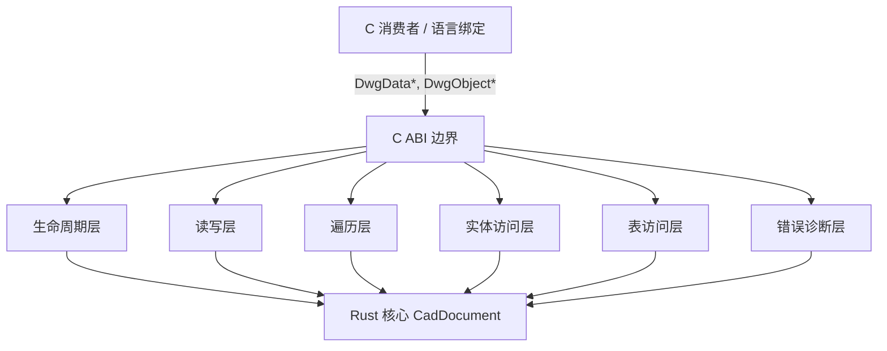
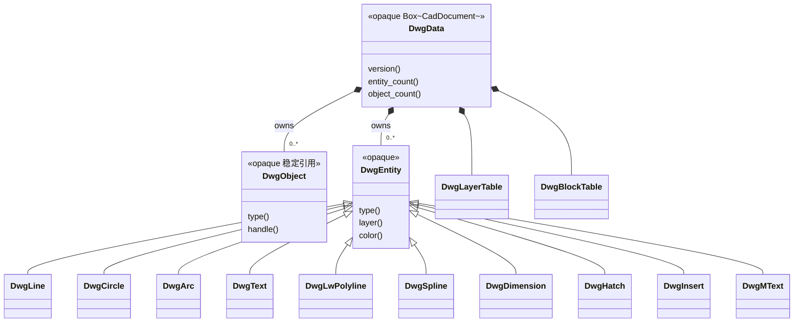
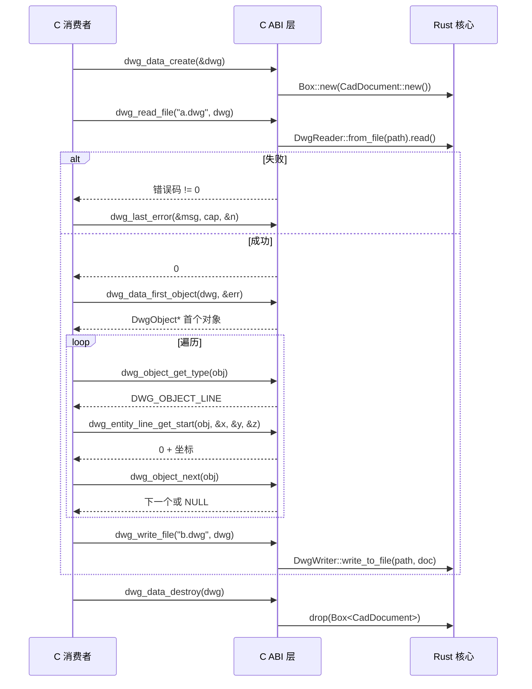

# acadrust FFI C API 设计规格（LibreDWG 风格，opaque 句柄）

> 目标：为 acadrust 构建一套完整、ABI 稳定、内存安全的 C ABI，能力对标
> LibreDWG（dwg_read_file / dwg_write_file / 对象遍历 / 实体访问），
> 使用 opaque 句柄 + getter/setter，不暴露 Rust 类型或内存布局。
> 支持 MinGW（已验证）与 MSVC 双工具链。

## 1. 目标与范围

- 覆盖 DWG + DXF 的读、写、对象遍历、实体/表访问、错误诊断。
- C 消费者：C/C++ 程序、其他语言绑定（Python/C#/Java 等）。
- 不追求逐字段复刻 LibreDWG 的裸结构体，而是功能等价 + ABI 稳定。
- 当前阶段只设计，不实现；实现走 writing-plans 再 TDD。

## 2. 架构分层（组件图）



## 3. 核心对象模型（UML 类图）



## 4. 典型流程（序列图）



## 5. 内存所有权规则（严格，C 接口规范）

这是整个 FFI 的约束性规则，实现与文档都必须遵守。

1. 文档是唯一所有权根：DwgData* 是 opaque 句柄，指向 Box<CadDocument>。
   dwg_data_create 分配，dwg_data_destroy 释放。没有其他所有权入口。
2. 对象/实体/表引用不单独释放：DwgObject*/DwgEntity* 是文档内对象的稳定只读
   引用（Rust 侧用 Box 存储对象保证地址稳定），生命周期由文档拥有。C 侧绝不
   能 free 这些指针。移除对象用 dwg_object_remove（而非 free）。
3. 字符串和字节数组优先 caller-owned buffer：统一签名
   int dwg_*_get_x(const DwgObject* o, char* buf, size_t cap, size_t* needed)。
   - 返回 0 成功，*needed 写实际所需字节（含 NUL）。
   - buf == NULL 且 cap == 0 是合法的只查询长度调用。
   - 失败返回错误码，*needed 写所需长度（如果可计算）。
4. callee-allocated 仅限字节数组：dwg_*_to_bytes 返回 uint8_t* 时配套
   dwg_free_buffer(void*) 释放。不用 libc free（跨 CRT 堆不匹配风险）。
5. 错误线程本地：int 返回码 + 线程本地错误槽。dwg_last_error(buf, cap, &n)
   读取当前线程最近错误消息；dwg_last_error_code() 返回错误码。
6. 回调不得持有句柄：遍历/通知回调只允许在回调期间使用 DwgObject*，不得保存
   到回调外。文档销毁后所有引用立即失效。
7. 空指针防御：所有函数对 NULL 句柄/输出参数做防御性检查，返回 DWG_EINVAL。
8. 跨堆分配唯一出口：任何需要 C 侧释放的内存（dwg_free_buffer）必须由 FFI
   层的单一 allocator 分配（Rust Vec 到 Box<[u8]> 到 into_raw）。

## 6. API 分组与命名规范

前缀 dwg_（DWG/DXF 通用），错误码 DWG_E*，类型枚举 Dwg*。符号全部 extern "C"
+ #[no_mangle]，头文件由 cbindgen 生成。

| 分组 | 代表性函数 |
|---|---|
| 生命周期 | dwg_data_create, dwg_data_destroy |
| 读写 | dwg_read_file, dwg_write_file, dxf_read_file, dxf_write_file, dwg_read_bytes, dwg_write_bytes |
| 遍历 | dwg_data_first_object, dwg_object_next, dwg_object_get_type, dwg_object_get_handle |
| 实体 getter | dwg_entity_line_get_start, dwg_entity_circle_get_center, dwg_entity_text_get_value |
| 实体 setter | dwg_entity_line_set_start, dwg_entity_circle_set_radius |
| 表访问 | dwg_layer_table_count, dwg_layer_get_name, dwg_layer_set_color |
| 对象访问 | dwg_dictionary_get_entry, dwg_xrecord_get_value |
| 错误诊断 | dwg_last_error, dwg_last_error_code, dwg_set_notification_callback |
| 内存 | dwg_free_buffer |
| 工具 | dwg_version_to_string, dwg_parse_version |

## 7. 类型映射（Rust 到 C）

| Rust | C | 说明 |
|---|---|---|
| CadDocument | DwgData*（opaque） | Box<CadDocument> |
| &EntityType / Handle | DwgObject*（opaque） | 文档内稳定引用 |
| Handle | uint64_t | handle 值 |
| Vector3 | 三个 double* 输出参数 | 避免结构体 ABI 分歧 |
| Vector2 | 两个 double* 输出参数 | |
| Color | int32_t（ARGB 原始值） | 与 Color::to_true_color_value 一致 |
| DxfVersion | int（枚举序数值）+ 字符串函数 | |
| String | caller-owned char* buffer | 见规则 3 |
| Vec<u8> | uint8_t* + dwg_free_buffer | 见规则 4 |
| Result<T, DxfError> | int 错误码 + 线程本地消息 | 见规则 5 |

## 8. 错误码设计

```c
#define DWG_OK              0
#define DWG_EINVAL          1
#define DWG_ENOMEM          2
#define DWG_EREAD           3
#define DWG_EWRITE          4
#define DWG_EVERSION        5
#define DWG_ENOTFOUND       6
#define DWG_EBUFFER         7
#define DWG_ETYPE           8
```

## 9. 分阶段实施路线图（每阶段 TDD）

| 阶段 | 交付 | 验收（红到绿） |
|---|---|---|
| P1 生命周期与读写 | dwg_data_create/destroy、dwg_read_file、dwg_write_file、错误码 + 线程本地错误 | C 测试程序读 cn_r2000.dwg 再写出，字节可读回且实体数一致 |
| P2 遍历与基础实体 | dwg_data_first_object/next、dwg_object_get_type、Line/Circle/Arc/Text/Point getter | C 遍历输出 3 实体（LINE/CIRCLE/TEXT），坐标与 LibreDWG 一致 |
| P3 完整实体 + 表 | 全部 40+ 实体类型 getter、Layer/Block/Style/DimStyle 表访问、setter | 全实体往返不丢字段；图层名/颜色读写一致 |
| P4 非实体对象 + 高级 | Dictionary/XRECORD/EED/ACIS 访问、通知回调、dwg_write_bytes | 复杂 cn.dxf 对象图遍历无 panic；EED 读回一致 |
| P5 头文件与工具链 | cbindgen 生成 dwg_api.h、MinGW+MSVC CI、README、示例 | 生成头文件无 Rust 类型泄漏，两端编译链接运行 |

## 10. TDD 策略

- 每个 C 函数先写 C 集成测试（tests/ffi/*.c 通过 cc crate 编译，Rust #[test]
  调用 C 二进制或直接调用 FFI 符号），红到绿。
- Rust 侧用 #[test] 直接调用 unsafe extern "C" 函数验证 ABI，不依赖真实 C 编译器。
- 每阶段用既有 ODA/LibreDWG 样本做端到端验证。

## 11. 风险与决策记录

- opaque 引用稳定性：DwgObject* 必须稳定到文档销毁。Rust 侧对象若用 Vec 存储，
  扩容会移动地址——因此文档内对象用 Box（或固定 arena）存储，保证地址稳定。
  这是 P2 实现时的关键点。
- MinGW/MSVC ABI 差异：double、uint64_t 在两工具链 ABI 一致；避免 long（Windows
  上 32 位，与 Linux 不同）、避免 bool 跨 ABI（用 int）。
- cbindgen 限制：opaque 类型需要 #[repr(C)] 空结构体 + cbindgen 配置。
- 逐步暴露，不做大爆炸：P1 先打通读写到错误最小闭环，验证 ABI 和所有权模型，
  再扩展。任何阶段出现内存模型问题都能在早期低成本修正。
